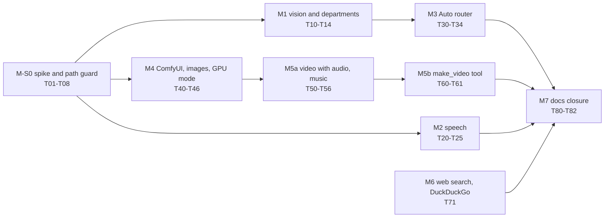

**Status:** proposed 2026-11-01; decisions D-M1 to D-M8 settled with the owner the same day (section 12), and the plan
checked against the code (section 16). Nothing is built. The next session is spike M-S0, from
[../../HANDOFF-2026-11-01-multimodal.md](../../HANDOFF-2026-11-01-multimodal.md). Tasks: section 14.

Background chapters (read before changing this plan):
[media generation on local GPUs](../../knowledge/media-generation-on-local-gpus.md),
[video with audio](../../knowledge/video-with-audio.md),
[speech and vision](../../knowledge/speech-and-vision.md),
[routing across experts, media and one GPU](../../knowledge/routing-across-models-and-media.md) (decision trees for
every routing stage).

# Multimodal stack: vision, speech, images, video with audio, music and routing per message

## 1. Goal

The owner wants one private stack that does all of this on SEKAIHOME:

- writing, coding, software architecture, science and art critique;
- image recognition, so the model can read a photo, a diagram or a painting;
- web search;
- image generation, image editing and style transfer;
- **video generation with audio**: sound effects in time with the picture, plus optional narration and music;
- music generation;
- speech in (dictation) and speech out (read the answer aloud);
- a router that picks the right "expert" for each message, so the owner does not pick a model by hand.

Every feature runs on the owner's own hardware. That is the private-first rule (AGENTS.md rule 9).

## 2. Where the repository stands (2026-11-01)

| Capability | State | Evidence |
|---|---|---|
| Routing | A different kind exists. Each department is a LiteLLM `complexity_router`. It picks a tier by difficulty, not by subject or media. All tiers resolve to `qwen3.5:9b`. | `scripts/stacklib/litellm_build.py`; README "Known issues": "A chat message cannot switch models" |
| Vision | Planned, not built. Plan B sends media to "a local vision model", chosen later (B-D3). | `supports_vision: False` in `litellm_build.py` (`LOCAL_INFO`); `"vision": False` in `agents_build.py` (`build_openwebui_model`) |
| Image generation, web search | Off on purpose. The installer is to turn them off. | `docs/plans/SHARED-COMPONENTS.md` S4 |
| Speech, video, music, style transfer | Not planned. ffmpeg and whisper.cpp appear only as privacy-gate scanners. | `SHARED-COMPONENTS.md` S1b; `winget_build.py` |
| Departments | Six, all for software work. Nothing for writing, science or art. | `agents/*.yaml` |

## 3. Constraints

| # | Constraint | Consequence |
|---|---|---|
| C1 | One RTX 3060 with 12 GB. The 9B holds 6.2 GB of model weights at 32k (8.0 GB on the card in total, measured at 16k) and stays loaded (`keep_alive: -1`). The FIM model keeps another 1.3 GB. Image models need about 9-11 GB on this card (FLUX or SDXL at int8). | One large GPU model at a time. Chat and media must hand over the GPU (section 7). |
| C2 | A cold load of the 9B from the USB SSD took 130-161 s (`memory/state.md`). | Many separate "expert" LLMs would mean minutes of waiting at each switch. The experts are prompts on one shared model (section 8). |
| C3 | Smart App Control blocks unsigned compiled modules file by file. It broke Phoenix (`memory/lessons.md`, 2026-10-26). | Each new PyTorch service (ComfyUI, Kokoro, custom nodes) must pass a spike before anything depends on it. |
| C4 | 32 GB DDR4. The usual desktop load leaves about 11-12 GB free. Wan 2.2 with offload wants 24-32 GB of system RAM. | Video runs with desktop apps closed, or not at all. Keep the 9B as primary; the 35B MoE leaves no RAM for media. |
| C5 | C: had about 36 GB free before the owner moved the Ollama models (about 30 GB) there on 2026-11-01; recheck it. The media models in section 5 add roughly 40-60 GB. **The owner selects which drives and folders agent sessions may work on; everything else is off-limits.** | Each session asks for the selection first. Model, cache and output paths are set explicitly inside it (`machines/<HOST>.yaml`). Anything outside it, the owner adds to the selection or copies himself. The stack's own tools enforce the list (task T08). |
| C6 | Native services only, no Docker or WSL2 (ADR 2026-10-24). | Each service runs as a uv environment or a vendor installer, managed by `stack.py` and the tray. |
| C7 | Licences must be checked before a model is named (lesson 2026-10-26). **Open licences only (D-M3):** Apache-2.0, MIT and similar, plus SDXL's CreativeML OpenRAIL++-M. Non-commercial and custom-licence weights are out. | Section 5 lists each licence. MMAudio, HunyuanVideo-Foley, LTX-2.x and FLUX.2 klein 9B are not used. |
| C8 | Ollama's image generation runs on macOS and Linux with CUDA only. | Images come from ComfyUI on this Windows machine. |
| C9 | The repository is public. | No personal data, paths under the user profile or file names from personal folders in commits. |

### Trade-off analysis

The research of 2026-11-01 comes down to five trade-offs. Each row names the choice this plan makes on SEKAIHOME and
what would change it.

| Trade-off | Option A | Option B | Choice here | What would change it |
|---|---|---|---|---|
| Experts | One model per subject: best possible specialist | Prompts on one shared model: no reloads | **B.** A model switch costs 130-161 s cold; ten switches a day is about 22 min of waiting (derived) | A card with room for two chat models, or a warm reload under about 10 s |
| Where routing per message lives | Gateway: every client gets it | Open WebUI pipe: sees attachments, pins per chat | **B** for subject; the gateway keeps difficulty tiers | A LiteLLM custom classifier that pins per session, if Claude Code and OpenCode need it |
| GPU sharing | Automatic hand-over per request | Owner switches a GPU mode; ComfyUI offloads as a safety net | **B** | Measured warm reload time (S0c) small enough to automate |
| Video with audio | Chain of specialists | Joint audio-video model | **Chain.** The only joint model found (LTX-2.x) has a custom licence (D-M3); on a 24 GB card it would otherwise win for short clips with speech | An open-licence joint model, and a card that fits it |
| Long media jobs | Reply in the chat | Job with progress and a link | **Job**: video takes minutes | Nothing on this hardware |

The trees that apply these choices, stage by stage, are in
[routing-across-models-and-media.md](../../knowledge/routing-across-models-and-media.md).

## 4. Target architecture

```
Open WebUI :3000  (owner's surface)
 |
 |-- chat ----> "Auto" pipe function ----> LiteLLM :4000 ----------------> Ollama :11434
 |              picks a department          department routers             qwen3.5:9b (text + vision)
 |              per chat                    (coding + writer, scientist,   one runner shared by all aliases
 |                                           architect, art-critic)        qwen2.5-coder:1.5b (FIM)
 |
 |-- mic ------> Whisper inside Open WebUI (CPU)
 |-- speaker --> Kokoro-FastAPI :8880 (CPU, OpenAI /v1/audio/speech)
 |-- image ----> ComfyUI :8188 (GPU)   Z-Image-Turbo / FLUX schnell; SDXL + IP-Adapter for style
 |
 +-- (v2) "make video" tool --> ComfyUI queue

ComfyUI UI :8188  (batch jobs, minutes each)
   video with audio:  Wan 2.2 TI2V-5B --> video-to-audio (Foley) --> + Kokoro narration --> + ACE-Step music
                      --> ffmpeg mix and mux --> MP4 with an AAC track
   music:             ACE-Step 1.5

Tray "GPU mode": Chat (Ollama owns the GPU)  <->  Media (Ollama unloaded, ComfyUI owns the GPU)
```

## 5. Components and model choices

All facts below are from web sources read on 2026-11-01. They are medium confidence until the spike (section 10)
measures them on SEKAIHOME.

| Capability | Component | Model and licence | GPU memory | Notes |
|---|---|---|---|---|
| Writing, coding, science, architecture, art critique | Ollama via LiteLLM | `qwen3.5:9b` (already pulled) | ~8 GB at 32k | New departments are prompts on the same runner (section 8). |
| Image recognition | Ollama via LiteLLM | `qwen3.5:9b`: the Qwen 3.5 family accepts images, 9B included | none extra | Confirm with `ollama show qwen3.5:9b` (look for `vision`). Fallback: a separate VL model that swaps in (reload cost, C2). |
| Speech to text | Open WebUI built-in Whisper (faster-whisper) | Whisper `small` or `base` (MIT) | CPU | No new service. 0.12.3 env (from the tagged source): `AUDIO_STT_ENGINE` empty for the built-in, `WHISPER_MODEL` (default `base`), `WHISPER_COMPUTE_TYPE` (default `int8`), models cached in `DATA_DIR/cache/whisper/models`. |
| Text to speech | Kokoro-FastAPI, native uv start script (`start-cpu.ps1`) | Kokoro-82M (Apache-2.0); wrapper Apache-2.0 | CPU | OpenAI-compatible at `http://127.0.0.1:8880/v1`, model `kokoro`. |
| Image generation | ComfyUI | Z-Image-Turbo 6B (Apache-2.0) as default; FLUX.1 schnell (Apache-2.0) as alternative; FLUX.2 klein 4B (Apache-2.0). Not FLUX.2 klein 9B (non-commercial, D-M3). | ~9-11 GB | Reported on a 3060: FLUX schnell int8 at 1024 px in 3-5 s, SDXL in 8-12 s. Open WebUI env: `ENABLE_IMAGE_GENERATION`, `IMAGE_GENERATION_ENGINE`, `COMFYUI_BASE_URL`, `COMFYUI_WORKFLOW`, `COMFYUI_WORKFLOW_NODES`, `IMAGE_SIZE`, `IMAGE_STEPS`. |
| Image editing, style transfer | ComfyUI, through Open WebUI's native image edit | SDXL (CreativeML OpenRAIL++-M, allowed by D-M3) + IP-Adapter (Apache-2.0); an edit model (FLUX.2 klein 4B edit, or a quantised Qwen-Image-Edit if its licence checks out) if one fits | ~9-11 GB | Pick the edit model in spike S0b by fit and quality. Open WebUI 0.12.3 has image editing with its own ComfyUI workflow: `ENABLE_IMAGE_EDIT`, `IMAGE_EDIT_ENGINE`, `IMAGES_EDIT_COMFYUI_BASE_URL`, `IMAGES_EDIT_COMFYUI_WORKFLOW`, `IMAGES_EDIT_COMFYUI_WORKFLOW_NODES`. |
| Video | ComfyUI | Wan 2.2 TI2V-5B, fp8 (Apache-2.0) | 12 GB with `--lowvram`; 24-32 GB system RAM | Reported 5-12 min for a short 720p clip on 3060-class cards. 720p, 24 fps, up to 5 s. |
| Sound for video (Foley) | ComfyUI custom node | **An open-licence video-to-audio model, to be found in spike S0e (D-M2, D-M3).** Candidates are named only after their code and weight licences are read; ThinkSound is the first to check. Excluded: HunyuanVideo-Foley (Tencent's own licence) and MMAudio (weights CC BY-NC 4.0). | to measure | If no open model fits, S0e stops and the owner decides again. |
| Narration for video | Kokoro-FastAPI | Kokoro-82M (Apache-2.0) | CPU | Same server as text to speech. |
| Music | ComfyUI (native template) | ACE-Step 1.5, released 2026-02-03 (MIT) | under 4 GB reported | Reported under 10 s per song on an RTX 3090; expect slower on a 3060. |
| Mix and mux | ffmpeg (already in `winget/configuration.winget`) | - | CPU | `loudnorm`, `sidechaincompress` for ducking, AAC into MP4. |
| Web search | Open WebUI web search | DuckDuckGo, no key (D-M5) | - | Queries leave the machine. Off by default, on per chat only. Env: `ENABLE_WEB_SEARCH`, `WEB_SEARCH_ENGINE`, `DDGS_BACKEND`; confirm the engine value (`duckduckgo` or `ddgs`) in the 0.12.3 retrieval router before writing it. |
| Routing | Open WebUI pipe function | classifier on the shared 9B through a `keep_alive: -1` alias (same runner) | none extra | Section 8. |

## 6. Video with audio

The owner requires audio on generated videos. Two routes exist.

### Route A (default): a composed pipeline in one ComfyUI workflow

Each stage loads its model, runs, and lets ComfyUI unload it before the next stage. Only one large model is on the
GPU at a time.

| Step | What | Model | Output |
|---|---|---|---|
| A1 | Generate the picture from text, or from a start image | Wan 2.2 TI2V-5B fp8 | frames, 720p, 24 fps, up to 5 s |
| A2 | Generate sound effects and ambience that match the frames | open-licence Foley model (D-M2, D-M3; chosen in S0e) | WAV, clip length |
| A3 | Optional: speak a narration script | Kokoro | WAV |
| A4 | Optional: generate a music bed of the clip's length | ACE-Step 1.5 | WAV |
| A5 | Mix: Foley at full level, music ducked under speech, loudness normalised; mux into the video | ffmpeg | MP4 (H.264 + AAC) |

Mixing targets, to confirm with the owner: integrated loudness -16 LUFS, true peak at most -1.5 dBTP, music
ducked by about 10 dB under narration.

Where A5 lives: a small module `scripts/stacklib/media_mux.py` with unit tests, called as
`uv run scripts/stack.py media mux --video v.mp4 --foley f.wav [--voice n.wav] [--music m.wav] --out out.mp4`. A
ComfyUI "Video Combine" node can mux a single track, but the mixing rules are easier to test in Python.

Lip-sync (a speaking face that matches the narration) is out of scope for v1. Wan 2.2 S2V is the candidate for a
later package.

### Route B (dropped by D-M3): one model makes picture and sound together

**Decided 2026-11-01:** not tried and not built. LTX-2.x is the only joint model found and its community licence is
not an open licence. Spike S0f and tasks T06 and T55 are removed. The facts below stay as background.

LTX-2.x generates video and synchronised audio in one pass. LTX-2.5 (released 2026-08-11) is a 22B model. Its
smallest community GGUF (Q3_K_S) is 12.6 GB, larger than this card. The vendor asks for 32 GB of VRAM, and a guide
calls 12-16 GB setups "a demo, not a workflow". Licence: the LTX-2 community licence, royalty-free for entities
under $10M revenue; the weights are gated on Hugging Face.

The decision rule first proposed for D-M1 (one time-boxed clip, adopt if under 20 minutes and preferred) is withdrawn.

### The hardware rule (background; not built)

The right route depends on VRAM more than on anything else
([video-with-audio.md](../../knowledge/video-with-audio.md) has the tree and the numbers):

| VRAM | Route | Why |
|---|---|---|
| under 24 GB (SEKAIHOME) | chain | LTX-2.5 does not fit; offloaded runs are "a demo, not a workflow" |
| 24 GB | joint for clips of about 5 s with speech or tight sync; chain otherwise | LTX-2.5 int8 needs 22.7 GiB for 5 s; 10 s clips can stall at the decode |
| 32 GB or more | joint by default, plus ACE-Step music mixed in with ffmpeg (the hybrid) | about 25 s for a 4 s 720p clip on an RTX 5090 |
| 128 GB unified memory | chain, and expect slow video | bandwidth-limited: a Wan 2.2 5B clip took about 14 min on a DGX Spark |

The table names LTX-2.5 because no open-licence joint model exists yet. Under D-M3 every machine uses the chain, so
the `media.video_route: chain | joint | auto` setting (task T54) is deferred until an open joint model appears.

### How the owner starts a video

- v1: from ComfyUI's own UI, with the workflow saved in the repo (`config/comfyui/workflows/video_with_audio.json`).
  A chat request would time out: a clip takes minutes.
- v2 (package M5b): an Open WebUI tool `make_video` that queues the same workflow through ComfyUI's API, reports
  progress with status events, and returns a link when the file is ready.

### Acceptance (Route A)

- One prompt produces a 5 s 720p MP4 with an audible, synchronised Foley track, in under 20 minutes on SEKAIHOME
  (target; record the real time).
- With narration and music turned on, speech stays intelligible over the music, and the file measures -16 LUFS +/-
  1 LU (`ffmpeg -af loudnorm=print_format=json`).
- No step needs Docker, WSL2 or a cloud API.

## 7. Sharing the GPU between chat and media

The 9B stays loaded for chat; image and video models need almost the whole card (C1). Options:

| Option | How | Trade-off |
|---|---|---|
| G1 (default) | A tray **GPU mode** switch. *Media*: unload every Ollama model (`POST /api/generate {"model": m, "keep_alive": 0}` for each model in `/api/ps`), then start ComfyUI. *Chat*: ask ComfyUI to free memory (`POST /free {"unload_models": true, "free_memory": true}`), stop it, and let the next chat reload the 9B. | Explicit and simple for one user. The first chat after media pays a reload (measure it in S0c). |
| G2 (safety net, always on) | Start ComfyUI with `--lowvram --reserve-vram 1.0` | An image request while the 9B is loaded still works, more slowly, by offloading to RAM. |
| G3 | Automatic: a filter unloads Ollama before each image request | Open WebUI calls the image engine outside the chat-completion filters, so this needs our own image tool. More code; revisit after G1 is in use. |

The tray already restarts Ollama and edits settings (`scripts/stacklib/settings.py`), so G1 is a small addition there.

## 8. Routing: experts and automatic choice per message

### 8.1 Experts are departments, not separate models

On this machine each extra LLM costs a reload (C2). So each expert is a department: a system prompt and evals on the
shared `qwen3.5:9b` runner. Proposed new departments (D-M8):

| id | For | Vision |
|---|---|---|
| `writer` | essays, emails, editing, tone | no |
| `scientist` | science and maths explanations, checking reasoning | yes (plots, figures) |
| `architect` | software architecture, trade-offs, ADRs | yes (diagrams) |
| `art-critic` | evaluating art, photos and designs | yes |

`agents/*.yaml` gains two optional keys:

```yaml
capabilities: {vision: true}          # copied into the Open WebUI model; default false
surfaces: [gateway, openwebui]         # default: all (claude, opencode, openwebui, gateway, evals)
```

`surfaces` keeps non-coding departments out of Claude Code and OpenCode, where they would add noise. Each new
department still gets evals, because the build generates the promptfoo gate from them.

`machines/_defaults.yaml:model_catalog` gains `vision: true` for `qwen3.5:9b`. `litellm_build.py` sets
`supports_vision` from the catalog instead of the hard-coded `False`.

### 8.2 The "Auto" model in Open WebUI

Decision trees for stage 1 (kind of request), stage 2 (department), stage 3 (tier), stage 4 (GPU owner), stage 5
(media route) and events during a chat are in
[routing-across-models-and-media.md](../../knowledge/routing-across-models-and-media.md).

A pipe function `config/openwebui/functions/auto_router.py` appears as one model, "Auto". For each chat it:

1. Applies rules first: code fences or file names go to `app-dev`; "review", "test", "security", "deploy" or
   "document" go to their departments; architecture words go to `architect`.
2. If no rule matches, asks the shared 9B for one department id, with a JSON schema answer. With an image attached,
   the allowed ids are only the vision departments (`scientist`, `architect`, `art-critic`), and `art-critic` is the
   fallback when the answer is invalid (D-M8). Without an image: `writer` for prose, `app-dev` for code-like text.
   The call goes through an alias with `keep_alive: -1` (`local-primary`, or a department's `-local` alias), not
   `local-small`: `local-small` sends `keep_alive: "30m"` (`litellm_build.py`), which would reset the shared runner's
   timer and let the 9B unload after 30 idle minutes.
3. Pins the department for the rest of the chat, so answers do not change voice mid-conversation. A message that
   starts with `@<department>` switches it.
4. Forwards the request with Open WebUI's internal `generate_chat_completion` (in `open_webui/utils/chat.py` at
   0.12.3) to the department's **Open WebUI workspace model**, not straight to the LiteLLM alias. The department's
   system prompt lives only in the workspace model (`params.system`, `agents_build.py:build_openwebui_model`); the
   LiteLLM alias carries none. The workspace model and the alias share one id today (`id == base_model_id`), so T31
   must confirm which one `generate_chat_completion` resolves, or add the prompt itself. The department's own
   complexity router still picks the tier.
5. Shows "Routed to: Writer" as a status event. It logs the department and the rule that matched, never the
   prompt text (privacy principle 5).
6. For requests to draw or make a video, answers with a pointer to the image button or the ComfyUI workflow (v1).

The "Auto" model itself must carry the `vision` capability, or Open WebUI will not pass attached images to the pipe.

This fixes the known issue "A chat message cannot switch models" for Open WebUI. Claude Code and OpenCode keep
choosing departments themselves.

Rejected: LiteLLM's semantic auto router (deprecated); squeezing departments into the complexity router's four
tiers; one model per subject (reloads, C2).

## 9. Speech and web search

**Speech to text.** Open WebUI's built-in Whisper on the CPU. Add `AUDIO_STT_ENGINE` (empty for the built-in),
`WHISPER_MODEL` and `WHISPER_COMPUTE_TYPE` to the `open_webui` env in `services.py:commands()`. Open WebUI keeps
saved admin settings in its database (`ENABLE_PERSISTENT_CONFIG` defaults to true), and they override env values, so
the smoke test must read the effective config back, not trust the env. The engine value list and the device are in
the STT code, not `config.py`; confirm them in the installed copy during T20.

**Text to speech.** Kokoro-FastAPI as a new native service `kokoro` on port 8880, started from its uv start script.
Open WebUI: `AUDIO_TTS_ENGINE=openai`, `AUDIO_TTS_OPENAI_API_BASE_URL=http://127.0.0.1:8880/v1`,
`AUDIO_TTS_MODEL=kokoro`, `AUDIO_TTS_VOICE` a Kokoro voice (the default `alloy` is OpenAI's).
**D-M4, decided:** Open WebUI talks to Kokoro and Whisper directly. Routing speech through LiteLLM's audio endpoints
so the Usage tab counts it (T25) stays optional for later.

A voice is biometric data (`docs/knowledge/privacy-for-llm-systems.md`). It stays local here. Check where Open WebUI
caches uploaded audio, and how long it keeps it.

**Web search.** Off today (S4). Every engine sends queries off the machine. SearXNG needs Docker or WSL2 on Windows,
which C6 rules out. **D-M5, decided 2026-11-01:** DuckDuckGo with no key, as a per-chat toggle only, never on by
default. `DECISIONS.md` records it as an exception to private first: the search query leaves the machine, the chat
and its model call do not. The department models keep `web_search: false` as a default capability; the toggle is per
chat.

## 10. Work packages

Every package is one pull request with a human checkpoint (AGENTS.md rule 5). Sizes: S under a day, M one to
three days, L more.

| # | Package | Size | Depends on | Acceptance |
|---|---|---|---|---|
| M-S0 | Spike on SEKAIHOME, owner present (changes the machine) | M | owner gives the media paths (D-M6) | Results table in `memory/state.md` for S0a-S0e below |
| M1 | Vision flag, `capabilities`/`surfaces` keys, four new departments with evals | S | S0a | `smoke` sends a small PNG to `art-critic` and gets a description naming its colour; build and tests pass |
| M2 | Speech: Whisper settings, `kokoro` service, tray entry | S | S0d | `smoke --media` speaks a sentence with Kokoro, transcribes it with Whisper and gets the words back |
| M3 | "Auto" pipe function and provisioning | M | M1 | 20 labelled sample prompts route correctly at least 18 times; status event shown; no prompt text in logs |
| M4 | `comfyui` service, Open WebUI image generation with a saved workflow and node map, style-transfer workflow, tray GPU mode | M | S0b, S0c | Image button returns a 1024 px image; switching GPU mode twice leaves no model loaded twice; chat works after media mode |
| M5a | Video with audio, Route A, music workflow, `media_mux.py` with tests | M-L | M4, S0e | Section 6 acceptance |
| M5b | `make_video` tool in Open WebUI | M | M5a | A chat request queues a clip and returns its link with progress shown |
| M6 | Web search (DuckDuckGo, D-M5) | S | - | Search runs only in a chat where the toggle is on; exception recorded in `DECISIONS.md` |
| M7 | Manuals, README, troubleshooting, `DECISIONS.md`, `memory/state.md` | S | each package | Each package updates its own docs; M7 closes the plan |

### Spike M-S0 checklist

| Check | What to do | Record |
|---|---|---|
| S0a | `ollama show qwen3.5:9b`; send one image through LiteLLM with `supports_vision` on | vision listed?; answer correct? |
| S0b | Install ComfyUI three ways if needed: the Windows desktop installer, the portable build, a uv venv. Keep the first that runs under Smart App Control. Generate a 1024 px Z-Image-Turbo image. | which install works; s per image; peak VRAM |
| S0c | Unload the 9B, run an image, reload the 9B; also run an image with the 9B loaded under `--lowvram` | reload time (warm OS cache); image time both ways |
| S0d | Start Kokoro-FastAPI on the CPU from its uv script | blocked or not; s per sentence |
| S0e | Read the code and weight licences of open video-to-audio candidates and keep only Apache/MIT-class ones; Wan 2.2 5B, one 5 s 720p clip; each remaining Foley candidate on it; ACE-Step 30 s track; desktop apps closed | licence per candidate; min per clip; peak RAM and VRAM; which Foley sounds right (or "none open", back to the owner) |

## 11. Files to change

| File | Change |
|---|---|
| `machines/<HOST>.yaml` (`agent_access`) | `allowed_roots`: the drives and folders the owner selected; empty means "ask"; checked by `stacklib/paths.py` (T08) |
| `machines/_defaults.yaml` | ports `comfyui: 8188`, `kokoro: 8880`; `services.comfyui` and `services.kokoro` (`native` or `off`, default `off`); a `media:` section (install dir, models dir, ComfyUI flags); `vision` in `model_catalog` |
| `machines/SEKAIHOME.yaml` | the owner fills in `media:` paths himself (C5) |
| `scripts/stacklib/services.py` | `SERVICE_ORDER`, `commands()`, `health_url()` (ComfyUI `/system_stats`; Kokoro health route to confirm), `EXPECTED_IMAGES`; Open WebUI env for audio and image generation |
| `scripts/stacklib/litellm_build.py` | `supports_vision` from the catalog; optional audio deployments (D-M4) |
| `scripts/stacklib/agents_build.py` | `capabilities` and `surfaces` keys |
| `agents/writer.yaml`, `scientist.yaml`, `architect.yaml`, `art-critic.yaml` | new departments with evals |
| `config/openwebui/functions/auto_router.py` | new pipe function (static asset, not generated) |
| `config/comfyui/workflows/*.json` | API-format workflows: image, style transfer, video with audio, music |
| `scripts/stacklib/settings.py`, `scripts/tray.py` | GPU mode switch; ComfyUI and Kokoro on/off |
| `scripts/stacklib/media_mux.py`, `scripts/stack.py` | `media mux` command |
| `scripts/stacklib/smoke.py` | `--media` checks: vision, TTS to STT round trip, one small image |
| `scripts/stacklib/winget_build.py` | ComfyUI desktop package, if S0b picks it and winget has it |
| `tests/` | services (new commands and health), agents build (`capabilities`, `surfaces`), `media_mux` filter graph |
| docs | README (configuration, commands, known issues), `docs/manuals/*`, `DECISIONS.md`, `memory/state.md` |

Generated files (`config/openwebui/*.json`, `infrastructure/litellm/config.yaml` and the others in AGENTS.md rule 1)
change only through `uv run scripts/stack.py build`.

## 12. Decisions for the owner

Settled with the owner on 2026-11-01 (Session 1).

| # | Decision | Default proposed | Decided |
|---|---|---|---|
| D-M1 | Video-with-audio route | By VRAM: chain under 24 GB; try Route B once (S0f) | **Chain (Route A).** The LTX-2 trial is dropped because of D-M3 (S0f, T06, T55 removed); `media.video_route` deferred |
| D-M2 | Foley model | Whichever sounds right in S0e | **By ear in S0e, among open-licence candidates only.** If none is open, back to the owner |
| D-M3 | Non-commercial or custom-licence weights | Personal use, labelled | **Open licences only** (Apache-2.0, MIT and similar). SDXL's CreativeML OpenRAIL++-M counts as allowed. Out: MMAudio, HunyuanVideo-Foley, LTX-2.x, FLUX.2 klein 9B |
| D-M4 | Speech through LiteLLM or direct | Direct first | **Direct.** T25 optional, later |
| D-M5 | Web search | Off | **DuckDuckGo, no key, per-chat toggle, off by default;** recorded as an exception to private first |
| D-M6 | Allowed drives and folders | Owner selects; `agent_access.allowed_roots` | **As proposed.** The list starts empty (empty means ask); the owner gives the media paths in Session 2; T08 refuses anything outside |
| D-M7 | GPU sharing | G1 tray switch plus G2 `--lowvram` | **As proposed** |
| D-M8 | New departments | `writer`, `scientist`, `architect`, `art-critic` | **As proposed, with a narrower image rule:** an attached image with no other rule match goes to the classifier, limited to the vision departments; `art-critic` is the fallback, not the first choice |

## 13. Risks

| Risk | Mitigation |
|---|---|
| Smart App Control blocks PyTorch modules in ComfyUI or Kokoro | Spike first (S0b, S0d); try the signed vendor installer; record the result as a lesson |
| Video jobs page the system (32 GB) | Close desktop apps for video; ComfyUI `--lowvram`; keep the 9B primary, never the MoE, during media work |
| Custom nodes run arbitrary code | Install only the nodes the saved workflows need; pin their commits in the workflow README |
| Licence drift between versions | Record the licence and the version per model in `config/comfyui/MODELS.md` |
| No open-licence Foley model is good enough (D-M3) | S0e reports it; the owner decides again (an exception, or videos with narration and music only until one appears) |
| Plan facts are from web pages, not measured here | Spike M-S0 replaces every timing in this plan with a SEKAIHOME measurement |
| Generated media leaves the private boundary through sharing | Outputs stay in the ComfyUI and Open WebUI data folders; nothing uploads automatically |

## 14. Task breakdown

Every task is small enough for one sitting and ends at a check. "Where" says whether the task needs SEKAIHOME (its
GPU or installed services) and whether the owner must be present. Tasks marked **any** can run in a cloud session or
on another machine, so they can start while the spike waits.



### M-S0: spike (SEKAIHOME, owner present) and path guard

| ID | Task | Size | Depends | Done when |
|---|---|---|---|---|
| T01 | Owner runs `uv run scripts/stack.py doctor` (it lists every drive, so agent sessions leave it to the owner) and `ollama show qwen3.5:9b`; then one image through a temporary gateway config with `supports_vision` on | S | - | `vision` listed or not; the answer names the image's content; results in `memory/state.md` |
| T02 | Find a ComfyUI install that runs under Smart App Control (desktop installer, portable, uv venv); make one 1024 px Z-Image-Turbo image | M | D-M6 | install route, seconds per image and peak VRAM recorded |
| T03 | GPU hand-over timings: unload the 9B, make an image, reload the 9B; and an image with the 9B loaded under `--lowvram` | S | T02 | warm reload time and both image times recorded |
| T04 | Start Kokoro-FastAPI on the CPU from its uv script | S | - | starts or blocked; seconds per sentence recorded |
| T05 | Licence check of open video-to-audio candidates (code and weights; Apache/MIT-class only, D-M3); Wan 2.2 5B 5 s 720p clip; each remaining Foley candidate on it; a 30 s ACE-Step track; desktop apps closed | M | T02 | licences, minutes per clip, peak RAM and VRAM, owner's Foley choice recorded; or "no open candidate" reported to the owner |
| T06 | Removed 2026-11-01: the LTX-2.x trial was dropped by D-M3 | - | - | - |
| T07 | Write the spike results into `memory/state.md`, `memory/lessons.md` and sections 5-6 of this plan | S | T01-T05 | pull request merged |
| T08 | Path guard: `agent_access.allowed_roots` in the machine profile (empty means ask); `stacklib/paths.py` refuses any `media:` path or tool cache (`HF_HOME`, ComfyUI model, input and output paths) outside it, and an empty list refuses them all; `model_store` and `OLLAMA_MODELS` predate the guard and get a warning, not an error; unit tests (can be built on any machine) | S | - | a media path outside the list fails the build with a clear message; tests cover drive letters, case, symlinks, `..` and an empty list |

### M1: vision and new departments

| ID | Task | Where | Size | Depends | Done when |
|---|---|---|---|---|---|
| T10 | `vision` in `model_catalog`; `litellm_build.py` sets `supports_vision` from it; unit test | any | S | T01 | generated config shows `supports_vision: true` for the 9B deployments; test passes |
| T11 | `capabilities` and `surfaces` keys in `agents_build.py`; unit tests. `surfaces` must also filter the model list in `opencode.json` (`update_opencode_json` lists every agent) and decide whether the orchestrator's `load_departments()` (`orchestrator/jobs.py`, reads every YAML) offers the new departments to `delegate` | any | S | - | Open WebUI JSON carries `vision`; departments without `claude` in `surfaces` produce no `.claude/agents` file and no `opencode.json` entry; the orchestrator behaviour is tested |
| T12 | `writer`, `scientist`, `architect`, `art-critic` YAMLs with prompts and at least three evals each; `capabilities: {vision: true}` for the last three | any (write), SEKAIHOME (evals need the gateway) | M | T11 | `stack.py build` passes; promptfoo evals pass on the local tier |
| T13 | `smoke`: send a small PNG to `art-critic` | SEKAIHOME | S | T10, T12 | smoke passes; the answer names the image's colour |
| T14 | AGENTS.md department list, README, user guide | any | S | T12 | docs list ten departments |

### M2: speech

| ID | Task | Where | Size | Depends | Done when |
|---|---|---|---|---|---|
| T20 | Whisper settings in the Open WebUI env (`AUDIO_STT_ENGINE`, `WHISPER_MODEL`, `WHISPER_COMPUTE_TYPE`; confirm the engine value and CPU device in the installed STT code); smoke reads back the effective setting, since saved settings override the env | any (code), SEKAIHOME (check) | S | - | the effective STT engine and model match the profile |
| T21 | `kokoro` service: port, `services.py` command, health and image names, off by default; unit tests | any | S | T04 | tests pass; `stack.py up kokoro` starts it on SEKAIHOME |
| T22 | Tray Settings entry to turn Kokoro on or off | any | S | T21 | Apply starts and stops it |
| T23 | Open WebUI TTS settings pointing at Kokoro (`AUDIO_TTS_ENGINE=openai`, `AUDIO_TTS_OPENAI_API_BASE_URL`, `AUDIO_TTS_MODEL=kokoro`, `AUDIO_TTS_VOICE` set to a Kokoro voice, not the default `alloy`) | any | S | T21 | read-aloud plays a Kokoro voice |
| T24 | `smoke --media`: Kokoro speaks a sentence, Whisper transcribes it | SEKAIHOME | S | T20, T23 | the words come back |
| T25 | Optional, not part of M2 (D-M4 chose direct): audio deployments in the gateway with `data_class: private` | any | S | owner asks | Usage tab counts speech requests |

### M3: the "Auto" router

| ID | Task | Where | Size | Depends | Done when |
|---|---|---|---|---|---|
| T30 | `routing_rules.py`: a pure function from message, attachments and pin to department and reason (or "ask the classifier, with these allowed ids"); unit tests | any | S | - (ids fixed by D-M8) | tests cover every rule in the stage-2 tree, including an image routed among the vision departments only |
| T31 | Pipe function `auto_router.py`: rules, classifier call on a `keep_alive: -1` alias with a JSON schema, pinning, `@department`, `generate_chat_completion` to the department's workspace model so its system prompt applies, status event | any (code), SEKAIHOME (check) | M | T30 | a chat shows "Routed to: X" and keeps it until `@` switches; the answer follows the department's system prompt; `ollama ps` still shows the 9B with no expiry after a routed chat |
| T32 | Install the function through Open WebUI's API (`stack.py webui-provision`), or document the import; the "Auto" model has the `vision` capability | any | S | T31 | a fresh Open WebUI gets "Auto" without manual steps; an attached image reaches the pipe |
| T33 | Labelled set of at least 20 prompts and a scorer, with image prompts for each vision department | any | S | T30 | at least 18 of 20 routed right |
| T34 | Log department and rule (never text); `why-routed` reads it | any | S | T31 | `why-routed` lists recent pipe decisions |

### M4: ComfyUI, images, style transfer, GPU mode

| ID | Task | Where | Size | Depends | Done when |
|---|---|---|---|---|---|
| T40 | `comfyui` service: `media:` section, port 8188, command with `--lowvram --reserve-vram 1.0`, health `/system_stats`; unit tests | any (code), SEKAIHOME (check) | M | T02 | `stack.py up comfyui` healthy on SEKAIHOME |
| T41 | GPU mode: unload Ollama models, `POST /free`, stop ComfyUI; tray switch with status; tests with stubbed HTTP | any (code), SEKAIHOME (check) | M | T40, T03 | two switches in a row leave one model loaded; chat works after media |
| T42 | Image workflow JSON and node map; Open WebUI image settings (`ENABLE_IMAGE_GENERATION`, `IMAGE_GENERATION_ENGINE`, `COMFYUI_BASE_URL`, `COMFYUI_WORKFLOW`, `COMFYUI_WORKFLOW_NODES`, `IMAGE_SIZE`, `IMAGE_STEPS`) | SEKAIHOME | S | T40 | the image button returns a 1024 px image |
| T43 | Style-transfer workflow (SDXL + IP-Adapter, or an edit model from S0b) wired as Open WebUI's native image edit (`ENABLE_IMAGE_EDIT`, `IMAGES_EDIT_COMFYUI_WORKFLOW`, `IMAGES_EDIT_COMFYUI_WORKFLOW_NODES`) | SEKAIHOME | S | T42 | a photo comes back in the reference picture's style |
| T44 | `config/comfyui/MODELS.md`: model, version, licence, size, source; pinned custom-node commits; a check that every listed licence is open (D-M3) | any | S | - (structure), T02 (rows) | every model in a saved workflow is listed with an allowed licence |
| T45 | `smoke --media`: one 512 px, 4-step image | SEKAIHOME | S | T42 | passes |
| T46 | winget entry for ComfyUI, if T02 picked the desktop installer and winget has it | any | S | T02 | generated winget file lists it |

### M5a: video with audio and music

| ID | Task | Where | Size | Depends | Done when |
|---|---|---|---|---|---|
| T50 | `media_mux.py`: ffmpeg filter graph with `loudnorm`, `sidechaincompress`, `amix` and mux; unit tests on the graph; integration test with synthetic tones when ffmpeg exists | any | M | - | tests pass; the mixed test file measures -16 LUFS +/- 1 LU |
| T51 | `stack.py media mux` command with a loudness report | any | S | T50 | command documented and tested |
| T52 | Route A workflow `video_with_audio.json` | SEKAIHOME | M | T05, T40 | one prompt gives frames, Foley, optional voice and music |
| T53 | Music workflow (ACE-Step 1.5) | SEKAIHOME | S | T05, T40 | a 30 s track from a prompt |
| T54 | Deferred 2026-11-01 (D-M1, D-M3): `media.video_route` waits for an open-licence joint model | - | - | - | - |
| T55 | Removed 2026-11-01: the LTX-2.5 joint workflow has a custom licence (D-M3) | - | - | - | - |
| T56 | Acceptance run on SEKAIHOME (section 6) | SEKAIHOME, owner | S | T51, T52 | time and loudness recorded in `memory/state.md` |

### M5b, M6, M7

| ID | Task | Where | Size | Depends | Done when |
|---|---|---|---|---|---|
| T60 | `make_video` Open WebUI tool: post to `/prompt`, poll `/history`, progress events, return a link | any (code), SEKAIHOME (check) | M | T52 | a chat request queues a clip and returns its link |
| T61 | Output folder, retention and size cap for generated media | any | S | T60 | old outputs are removed by the rule the owner sets |
| T70 | Done 2026-11-01: D-M5 is DuckDuckGo, per-chat toggle | owner | - | - | decision recorded |
| T71 | `ENABLE_WEB_SEARCH`, `WEB_SEARCH_ENGINE` (confirm `duckduckgo` or `ddgs` in the 0.12.3 retrieval router) and `DDGS_BACKEND` in the Open WebUI env; department models keep `web_search: false` as the default; the `DECISIONS.md` exception entry exists | any (code), SEKAIHOME (check) | S | - | search runs only in a chat where the toggle is on |
| T80 | User guide: one section per feature | any | S | each package | a newcomer can use each feature from the guide |
| T81 | Troubleshooting rows: Smart App Control blocks, out of memory at decode, workflow rejected, slow reload | any | S | each package | rows added |
| T82 | Close the plan: Outcome note here, design index status, `memory/state.md` | any | S | all | plan marked done |

Tasks that can start now, without SEKAIHOME: T08, T11, T12 (prompts and evals written; run on SEKAIHOME), T30, T44
(structure), T50, T51, T71 (code).

## 15. Sources (read 2026-11-01)

- Ollama image generation, macOS and Linux CUDA only: https://ollama.com/blog/image-generation (via release notes mirrored at https://gitea.alexlebens.dev/alexlebens/infrastructure/pulls/3436)
- Qwen 3.5 on Ollama accepts images, all sizes including 9B: https://summarizemeeting.com/en/news/ollama-qwen-3-5-local-tool-calling-multimodal
- ComfyUI on an RTX 3060 12 GB, image models: https://specpicks.com/reviews/comfyui-rtx-3060-12gb-local-image-generation-2026
- Video on 12 GB, Wan 2.2 TI2V-5B: https://localaimaster.com/blog/local-text-to-video-low-vram
- LTX-2 VRAM on consumer cards: https://localaimaster.com/blog/ltx-2-local-setup-guide
- LTX-2.5 sizes and licence: https://creativeaishow.com/ltx-2-5-the-free-open-weights-ai-video-model-with-native-audio-and-the-real-vram-bill/
- HunyuanVideo-Foley ComfyUI nodes and VRAM: https://github.com/phazei/ComfyUI-HunyuanVideo-Foley ; upstream https://github.com/Tencent-Hunyuan/HunyuanVideo-Foley
- MMAudio weights licence: https://huggingface.co/AEmotionStudio/mmaudio-models/blob/main/README.md ; upstream https://github.com/hkchengrex/MMAudio
- ACE-Step 1.5 licence, VRAM, speed: https://gigazine.net/news/20260204-ace-step-music-generation/ ; ComfyUI support https://www.comfyui.org/en/ace-step-15-is-now-available-in-comfyui
- Kokoro-FastAPI native start and licence: https://github.com/remsky/Kokoro-FastAPI
- LiteLLM auto routing (semantic router deprecated): https://docs.litellm.ai/docs/proxy/auto_routing
- Open WebUI pipe functions: https://docs.openwebui.com/features/plugin/functions/pipe
- Open WebUI with ComfyUI, stock workflow rejected without a workflow and node map: https://github.com/thekaveh/atlas/wiki/Service-Open-Webui

## 16. Review against the code, 2026-11-01 (Session 1)

The session could use only this repository's worktree and its scratchpad (D-M6), so installed versions come from
`memory/state.md`, and Open WebUI's setting names from its source at tag v0.12.3 on GitHub. Not run: `stack.py
doctor` (it lists every drive) and `ollama show` (Ollama reads its model store); both moved into T01 for the owner.
`stack.py status`: only Ollama was up; LiteLLM, Open WebUI, Phoenix and the orchestrator were down and were left alone.

Confirmed in the code:

- `supports_vision: False` in `LOCAL_INFO` (`litellm_build.py`) and `"vision": False` in `build_openwebui_model`
  (`agents_build.py`); `model_catalog` has no `vision` key yet.
- Department routers: tiers, `plan_mode_min_tier`, `keyword_tier_rules`, stall escalation and context-window
  escalation at 0.9, as the stage-3 tree shows; the build refuses non-private targets (`check_private`).
- `services.py`: `SERVICE_ORDER`, `commands()`, `health_url()` and `EXPECTED_IMAGES` are where new services go; the
  `open_webui` env is where audio, image and search settings go.
- `settings.py` already restarts Ollama and rebuilds on Apply, so the GPU mode (T41) fits there.

Corrected in this plan:

- The Auto pipe must forward to the department's Open WebUI workspace model (or add the system prompt itself): the
  LiteLLM department alias carries no system prompt (section 8.2, T31).
- The classifier call must not use `local-small`, whose `keep_alive: "30m"` resets the shared 9B runner's timer
  (section 8.2, T31).
- The "Auto" model needs the `vision` capability to receive images (T32).
- An attached image no longer goes straight to `art-critic` (D-M8, stage-2 tree).
- `surfaces` must also cover `opencode.json` and the orchestrator's department list (T11).
- Open WebUI 0.12.3 setting names filled in (sections 5 and 9, T20, T23, T42, T71); its native image edit is the
  style-transfer path (T43).
- T12's evals need the gateway, so they run on SEKAIHOME.
- T08 must not fail the build on the existing `model_store`, which predates the guard.
- Stage 6 of the routing chapter claimed that a reply asks to shorten past 90% of the context; nothing does that.
