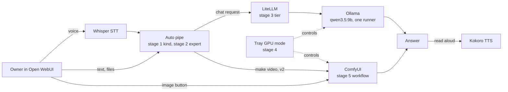
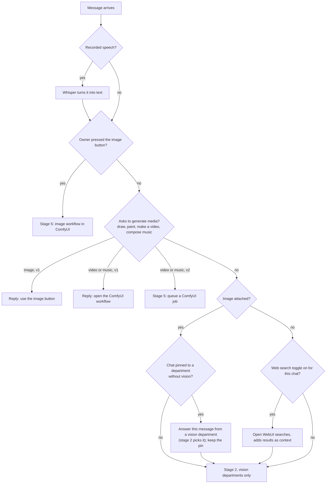
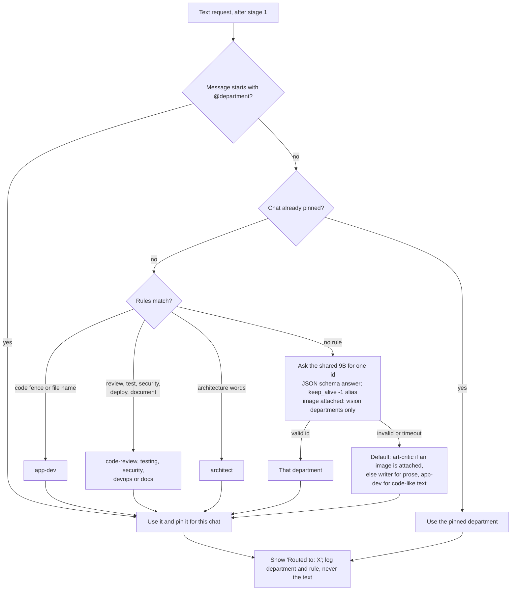
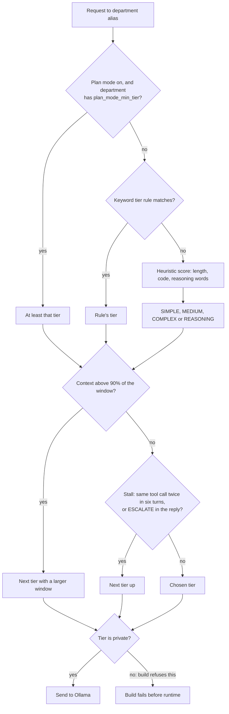
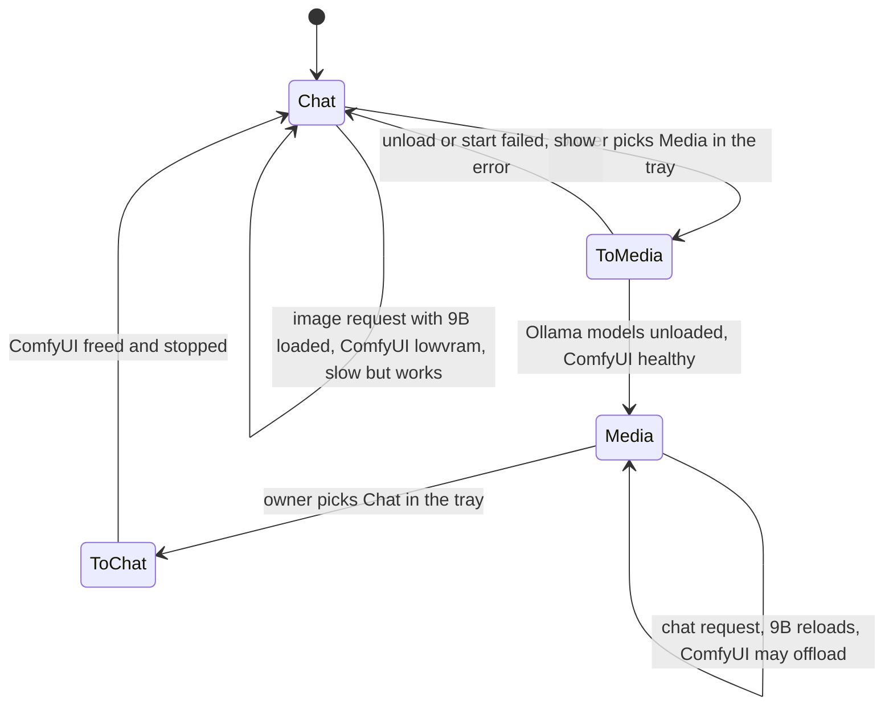
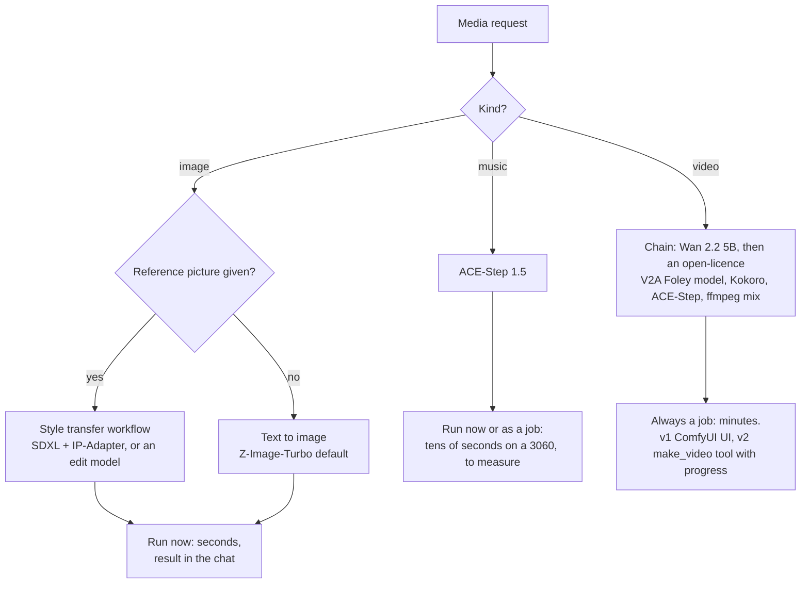

# Routing across experts, media and one GPU

## What this is and why the project needs it

Once the stack can write, code, read images, talk, draw, make videos and make music, every message raises several
questions. Is this text, a picture to read, or something to generate? Which expert should answer? How strong a tier?
Is the GPU free for it? Should it run now, or as a job that finishes later? Each question is answered at a different
**stage**, by a different program. This page lays out those stages as decision trees, explains the trade-offs behind
each, and shows what happens when things change in the middle of a chat.

Background: [llm-gateway-and-routing.md](llm-gateway-and-routing.md) (section 17, routing patterns) explains the
gateway's complexity router. [media-generation-on-local-gpus.md](media-generation-on-local-gpus.md) explains why chat
and media take turns on the GPU. [video-with-audio.md](video-with-audio.md) explains the video route.

## The ideas, built up from zero

### Routing happens in layers

No single program can make every decision, because each one sees a different part of the request.

| Stage | Question | Decided by | Why there |
|---|---|---|---|
| 0. Input | Is the input speech? | Open WebUI (Whisper) | Only the browser and Open WebUI see the microphone |
| 1. Kind | Read text, read an image, or generate media? | Open WebUI "Auto" pipe, plus the image button | It sees attachments and the chat's history |
| 2. Expert | Which department? | Open WebUI "Auto" pipe | It can pin a choice for the whole chat |
| 3. Tier | How strong a model inside the department? | LiteLLM complexity router | Every client passes through the gateway |
| 4. GPU | Who owns the GPU now: chat or media? | Tray GPU mode (owner), ComfyUI `--lowvram` (safety) | Only one large model fits at a time |
| 5. Media route | Which workflow, which video route, now or as a job? | ComfyUI workflow choice, `media.video_route` setting | Depends on the hardware and the job length |
| 6. Output | Read the answer aloud? | Open WebUI (Kokoro) | A per-user choice in the browser |



### Experts are prompts on one model, not separate models

The obvious design is one specialist model per subject. On this hardware it is the wrong one. A cold load of the 9B
from the USB SSD took 130-161 s. If the owner switches subject ten times a day and each switch loads a different
model, that is roughly 10 x 130 s, about 22 minutes of waiting a day (derived, not measured). A department is instead
a system prompt, evals and settings on the same runner, so switching costs nothing. The gateway already shares one
runner across all eight 9B aliases because they use the same model and the same load options
([local-llm-inference.md](local-llm-inference.md)).

A separate model earns its place only when the shared one cannot do the job at all: a media model, or a much stronger
model on bigger hardware.

### Why the per-message router lives in Open WebUI, not the gateway

LiteLLM's routers choose among **tiers of difficulty** inside one alias. Its semantic router, which matched intent, is
deprecated. Forcing departments into the four tiers would break the tier logic every department already uses. Open
WebUI's **pipe function** is a model-shaped plug-in: it receives the chat, can call another model internally
(`generate_chat_completion`), can show status messages, and can remember a choice per chat. So stage 2 lives there.
The cost: only Open WebUI gets automatic routing. Claude Code and OpenCode still pick departments themselves, as
they do now.

### Pinning: why the expert stays fixed for a chat

If every message were routed fresh, a chat could jump from the writer to the scientist and back, changing voice and
losing the thread. The pipe therefore **pins** the first choice for the chat. The owner can switch with
`@<department>` at the start of a message. An attached image does not unpin; it only checks that the pinned
department can read images.

## The decision trees

### Stage 0 and 1: what kind of request is this?



Trade-off: detecting "generate media" from words is fuzzy. In v1 the pipe only points the owner to the right button
or workflow, so a wrong guess costs one sentence, not a 10-minute GPU job.

### Stage 2: which expert?



Trade-offs: rules are instant and predictable but miss unusual phrasing; the classifier call catches those but adds
a short model call (on the same loaded runner, so no reload). A labelled set of at least 20 prompts measures the
mix (plan task T33).

Two details the code forces (checked 2026-11-01). The classifier call goes through an alias with `keep_alive: -1`:
`local-small` sends `"30m"`, and Ollama would apply that to the shared runner. And the chosen department is reached
through its Open WebUI workspace model, because only that model carries the department's system prompt.

An image used to go straight to `art-critic`. Decision D-M8 narrowed that rule: a plot attached to a science question
belongs with `scientist`, a diagram with `architect`.

### Stage 3: which tier inside the department?

This stage exists today. Each department alias is a LiteLLM complexity router; on the reference machine every tier resolves to
the same `qwen3.5:9b`, so the stage matters only once a stronger local model exists.



Private first holds here by construction: the build refuses any tier, fallback or default that names a non-private
deployment ([../../AGENTS.md](../../AGENTS.md) rule 9).

### Stage 4: who owns the GPU?



| Event | In Chat mode | In Media mode |
|---|---|---|
| A chat message | 9B answers at once | 9B reloads first (cold 130-161 s; warm unknown), then competes with ComfyUI |
| The image button | ComfyUI runs in `--lowvram`, slower | ComfyUI runs at full speed |
| A video job | Not recommended; switch first | Runs; close desktop apps for RAM |

Trade-off: an explicit switch is simple and predictable for one owner. Automatic switching per request would need our
own code on every image call and could thrash between a 2-minute reload and a 10-minute video.

### Stage 5: which media route, now or later?



The video branch was a choice between the chain and a joint model (LTX-2.5) by VRAM. Decision D-M3 (open licences
only) removed the joint model, so every machine takes the chain until an open joint model exists;
[video-with-audio.md](video-with-audio.md) keeps the hardware rule as background.

Trade-off: a request that takes minutes cannot be a normal chat reply, because the browser request would time out
and the chat would block. Jobs report progress and hand back a link when done.

### Stage 6 and events during a chat

Things change mid-conversation. The table says what each stage does.

| What happens | What the stack does | Stage |
|---|---|---|
| The owner attaches an image to a pinned writer chat | Checks the writer's `vision` capability; if it has none, stage 2 picks a vision department for this one answer and keeps the pin | 1, 2 |
| The owner types `@scientist` | Switches and re-pins; the next answer shows "Routed to: Scientist" | 2 |
| The conversation grows past 90% of the context | Gateway moves to a tier with a larger window. On the reference machine every tier is the same 32k model, so nothing changes and the request fails or is cut once it no longer fits; nothing asks the owner to shorten yet | 3 |
| The model repeats the same tool call, or writes `ESCALATE` | Gateway bumps the tier for the next turn | 3 |
| The owner asks for a video in the middle of a chat | v1: points to the workflow; v2: queues a job and keeps chatting | 1, 5 |
| A video job is running and the owner asks a question | The 9B reloads if it was unloaded; ComfyUI may slow down; the tray shows Media mode | 4 |
| Ollama is down | Clear error: "the local model is unavailable"; never a cloud fallback | 3 |
| ComfyUI is down or blocked by Smart App Control | Image button shows the error; chat carries on | 5 |
| The owner turns on read-aloud | Each answer goes to Kokoro after it finishes; no GPU use | 6 |

### One message, end to end

```mermaid
sequenceDiagram
  participant U as Owner (browser)
  participant W as Open WebUI
  participant P as Auto pipe
  participant L as LiteLLM
  participant O as Ollama 9B
  participant K as Kokoro
  U->>W: voice note + photo
  W->>W: Whisper transcribes on the CPU
  W->>P: text + image
  P->>P: no pin, no rule; classifier picks among vision departments: art-critic; pin it
  P-->>U: status "Routed to: Art critic"
  P->>L: art-critic workspace model (its system prompt added)
  L->>L: complexity router picks a tier (all local)
  L->>O: request with the image
  O-->>L: answer
  L-->>P: answer
  P-->>W: answer
  W->>K: text to speech
  K-->>U: spoken answer
```

## Rules of thumb and typical numbers

- One shared chat model; experts are prompts. Switching an expert costs nothing; switching a model costs minutes.
- Decide each question at the stage that can see it: the pipe for kind and expert, the gateway for tier, the owner
  for the GPU, the hardware for the video route.
- Pin the expert per chat; let the owner override with `@department`.
- Anything that takes minutes is a job with progress, never a blocking chat reply.
- Log the decision and its reason, never the prompt text.

## Common misconceptions and edge cases

- **"A smart router should guess everything."** Wrong guesses on media are expensive (a 10-minute job). Point, do not
  act, until the owner asks.
- **"The gateway can route images to ComfyUI."** LiteLLM has image endpoints, but Open WebUI's image button talks to
  ComfyUI directly with a workflow; the gateway does not see those calls.
- **"Routing by intent and by difficulty are the same."** Departments are about subject; tiers are about difficulty.
  They are separate stages on purpose.
- **"More experts means more models."** Not here: more experts means more prompts and evals on the same runner.

## How the project uses it

- Stage 2 is the "Auto" pipe function (plan package M3, tasks T30-T34).
- Stage 3 is unchanged (`scripts/stacklib/litellm_build.py`).
- Stage 4 is the tray's GPU mode (task T41) with ComfyUI `--lowvram` as the safety net.
- Stage 5's video route is the chain on every machine for now; the `media.video_route` setting (task T54) is
  deferred until an open-licence joint model exists.

## What we found

Nothing measured yet. The reload time after a media job (spike S0c) and the router's accuracy on the labelled set
(T33) are the two numbers this design depends on most.

## Open questions

- Is a warm reload of the 9B fast enough that an automatic GPU switch becomes reasonable?
- Does the classifier call stay under one second on the shared runner?
- Should Claude Code and OpenCode get the same routing later, through a LiteLLM custom classifier?

## Sources and further reading

| Source | Author / year | Good for |
|---|---|---|
| [LiteLLM auto routing](https://docs.litellm.ai/docs/proxy/auto_routing) | LiteLLM, 2026 | complexity router, classifiers, semantic router deprecation |
| [Open WebUI pipe functions](https://docs.openwebui.com/features/plugin/functions/pipe) | Open WebUI, 2026 | forwarding to another model from a pipe |
| [llm-gateway-and-routing.md](llm-gateway-and-routing.md) | project, 2026-11 | routing patterns and the current router |
| [ORCHESTRATOR-DESIGN.md](../ORCHESTRATOR-DESIGN.md) section 7 | project, 2026-10 | escalation rules: context, stall, keywords |
| [memory/state.md](../../memory/state.md) | project, 2026-10 | load times and runner sharing |

## Changes

- 2026-11-01: first version.
- 2026-11-01: checked against the code and the owner's decisions D-M3 and D-M8: image routing among vision
  departments, classifier on a `keep_alive: -1` alias, workspace model for the system prompt, chain-only video,
  corrected the 90% context row.
