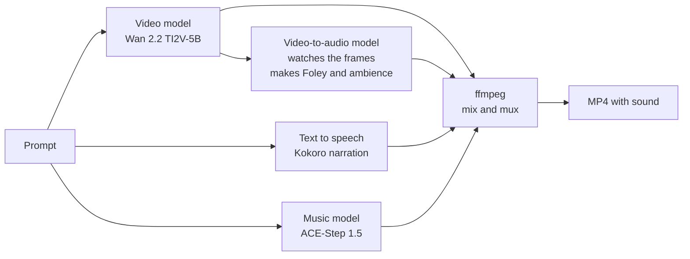
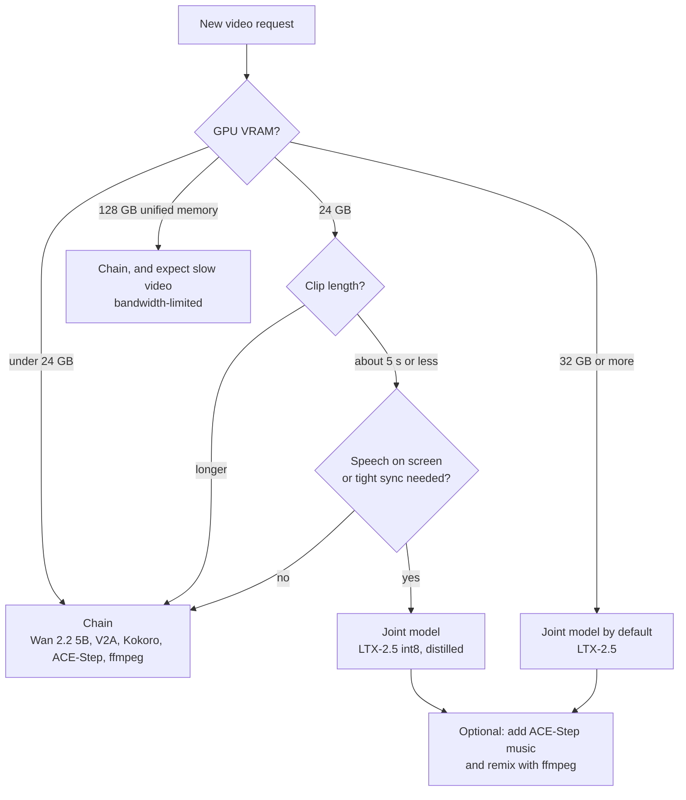

# Video with audio: one model or a chain of models

## What this is and why the project needs it

The owner wants generated videos to have sound: effects in time with the picture, and sometimes a voice and music.
There are two ways to get that. A **joint model** makes picture and sound together in one pass. A **chain** uses one
model per part (picture, sound effects, voice, music) and mixes the results. Which one is better depends mainly on
the graphics card. This page explains both, the trade-offs, the software that runs them, and how to mix the sound so
the result is pleasant to hear. Read [media-generation-on-local-gpus.md](media-generation-on-local-gpus.md) first.

## The ideas, built up from zero

### The parts of a soundtrack

A film soundtrack has layers. Keep them apart in your head, because different models make them:

| Layer | Example | Must line up with the picture? |
|---|---|---|
| Sound effects ("Foley") | footsteps, a door, rain, a cup on a table | Yes, to the frame |
| Ambience | room tone, wind, traffic | Loosely |
| Speech | narration or a character talking | Narration: no. A speaking face: yes, to the lips |
| Music | a background track | No, but it must fit the length and stay under speech |

### Route 1: a joint model

A joint audio-video model (LTX-2, LTX-2.5) has one network that produces video latents and audio latents in the same
pass; separate VAEs decode them into frames and sound. Because both come from the same pass, a door slam lands on the
frame where the door shuts, and a speaking mouth can move with the words. LTX-2.5 (released 2026-08-11) is a 22B
model. The LTX-2 model card warns that sound without speech can be of lower quality.

### Route 2: a chain

The chain runs one specialist after another:

The key link is the **video-to-audio** (V2A) model. It takes the finished frames as input, so its sound effects line
up with what happens on screen. Candidates: HunyuanVideo-Foley (runs under 8 GB in fp8; Tencent's own licence) and
MMAudio (about 2 GB of fp16 weights; CC BY-NC 4.0, non-commercial). The chain cannot make lips match speech; that
needs a speech-driven video model (for example Wan 2.2 S2V), which the plan leaves for later.

### The trade-offs

| | Chain (several models) | Joint model (LTX-2.x) |
|---|---|---|
| Fits 12 GB | Yes: each step loads, runs and unloads | Barely: the smallest LTX-2.5 GGUF is 12.6 GB; guides call 12-16 GB "a demo, not a workflow" |
| Sound-picture sync | Good for effects (the V2A model watches the frames); no lip-sync | Best: one pass; lip-sync possible |
| Control | High: change music or voice without making the video again | Low: any sound change means a new clip |
| Sound quality | Each layer from a specialist | Uneven: weaker without speech, per the LTX-2 model card |
| Speed | Several loads in a row; the video step dominates | One pass; fast only when it fits in VRAM |
| Fixing a bad result | Redo only the failed step | Redo everything |
| Licences | Mixed: Wan, Kokoro, ACE-Step permissive; both V2A candidates restricted | One custom licence (free under $10M yearly revenue) |
| Setup | More nodes, a mixing step | One model, one workflow |

### The hardware rule

Picture and sound in one pass only pays off when the whole model stays in VRAM.

Numbers behind it (web reports, 2026-08 to 2026-11): LTX-2.5 int8 needs 22.7 GiB fully loaded for about 5 s clips;
a 3090 makes a distilled 5 s clip in about 2.5 min; a 5090 makes a 4 s 720p clip in about 25 s and an 8 s clip in about
3 min with weight streaming; on 24 GB, 10 s clips can stall at the final decode.

**The hybrid** is the best use of a 24-32 GB card: let the joint model make picture, speech and ambience, then lay an
ACE-Step music bed under it and mix with ffmpeg. You get the joint model's sync and the chain's control of music.

### Software that runs LTX-2

| Software | Kind | Private? | Use here |
|---|---|---|---|
| ComfyUI with the LTXVideo nodes (ComfyUI Manager) | local app | yes | **Recommended by Lightricks; the plan's choice** |
| Official repo `Lightricks/LTX-2` (`ltx-core`, `ltx-pipelines`, `ltx-trainer`) | local Python; `uv sync`; tested with Python 3.12+, CUDA above 12.7, PyTorch about 2.7 | yes | scripts and batch jobs; Windows support not stated |
| Hugging Face Diffusers (`LTX2Pipeline`, `LTX2LatentUpsamplePipeline`) | local Python library | yes | calling it from our own code |
| `ltx-trainer` | local fine-tuning of the dev model | yes | only to train a style |
| LTX Studio playground, fal, Colab, Kaggle, Hugging Face Spaces | cloud | **no** | outside the privacy boundary |

Ollama, LiteLLM and Open WebUI cannot run it: Ollama runs language models and a few image models, LiteLLM is a
gateway, Open WebUI is a front end.

Version care: LTX-2.5 files do not work with LTX-2.3 nodes. Weights come in bf16, fp8, nvfp4, int8 and a distilled
8-step version. On an RTX 30-series card use int8 or GGUF; fp8 and nvfp4 need newer cards for native speed. The
weights are gated: accept the licence and sign in to Hugging Face once.

### Mixing the sound: loudness, ducking and muxing

Generated layers come out at random volumes. Three ffmpeg steps make them listenable:

- **Loudness normalisation.** Loudness is measured in **LUFS** (loudness units relative to full scale). The `loudnorm`
  filter implements the EBU R128 method. Common targets: about -14 LUFS for streaming platforms, -16 LUFS for web
  video and podcasts, -23 LUFS for European broadcast. Also cap the **true peak** at about -1.5 dBTP so the sound does
  not clip after compression.
- **Ducking.** When a voice speaks, the music should drop (about 10 dB) and come back afterwards. ffmpeg's
  `sidechaincompress` filter does this, with the voice as the trigger.
- **Muxing.** Put the mixed sound (AAC) and the video (H.264) into one MP4 without re-encoding the video
  (`-c:v copy`).

The plan puts this in a small, tested Python module (`scripts/stacklib/media_mux.py`) instead of a ComfyUI node,
because the rules are easier to test in code.

## Rules of thumb and typical numbers

- Under 24 GB of VRAM: chain. At 24 GB: joint model for short clips with speech. From 32 GB: joint model by default.
- Keep clips at about 5 s on 12-24 GB cards; longer clips fail at the decode or take far longer.
- On a 3060, expect 5-12 min for the video step of a 5 s 720p clip; the sound steps add little by comparison.
- Mix to -16 LUFS integrated, true peak at most -1.5 dBTP, music ducked about 10 dB under speech, unless the owner
  sets other targets.

## Common misconceptions and edge cases

- **"A joint model is always better because it is in sync."** Only if it fits. On 12 GB it runs as a slow demo, and
  its sound without speech is weaker by its own maker's account.
- **"A chain cannot be in sync."** The V2A step watches the frames, so effects do line up. What a chain cannot do is
  lip-sync.
- **"Any open model can be used in a product."** Both V2A candidates and LTX-2 have restrictions. Personal use is
  usually fine; check before anything else.
- **"A big unified-memory box is the best video machine."** It fits everything but is slow for diffusion.

## How the project uses it

- Default on SEKAIHOME: the chain, in one ComfyUI workflow (`config/comfyui/workflows/video_with_audio.json`), plus
  `uv run scripts/stack.py media mux` for the mix (plan package M5a).
- A machine setting `media.video_route: chain | joint | auto` (proposed, task T54). `auto` applies the hardware rule
  above from the detected VRAM.
- LTX-2.x gets one time-boxed try on SEKAIHOME (spike S0f). It becomes the default only on a 24 GB or larger card.
- Lip-sync is out of scope for the first version.

## What we found

Not measured here yet. All numbers are web reports read on 2026-11-01.

## Open questions

- Which V2A model sounds right on Wan 2.2 clips, and is its licence acceptable to the owner (D-M2, D-M3)?
- How long does the full chain take on SEKAIHOME, end to end?
- Does an LTX-2.5 Q3 GGUF finish a 5 s clip at all on 12 GB with 32 GB of RAM?

## Sources and further reading

| Source | Author / year | Good for |
|---|---|---|
| [Lightricks/LTX-2 model card](https://huggingface.co/Lightricks/LTX-2) | Lightricks, 2026 | every way to run LTX-2, checkpoint variants |
| [Diffusers LTX-2 pipeline](https://huggingface.co/docs/diffusers/main/en/api/pipelines/ltx2) | Hugging Face, 2026 | Python pipeline classes |
| [LTX-2 repository](https://github.com/Lightricks/LTX-2) | Lightricks, 2026 | `ltx-pipelines`, `ltx-trainer` |
| [LTX-2.5 hardware guide](https://runaihome.com/blog/ltx-2-5-local-ai-video-hardware-guide-2026/) | RunAIHome, 2026-08 | VRAM and speed by card |
| [LTX-2.5 sizes and licence](https://creativeaishow.com/ltx-2-5-the-free-open-weights-ai-video-model-with-native-audio-and-the-real-vram-bill/) | Creative AI Show, 2026 | GGUF sizes, licence |
| [LTX-2 local setup](https://localaimaster.com/blog/ltx-2-local-setup-guide) | LocalAIMaster, 2026 | why 12-16 GB is a demo, offload flags |
| [ComfyUI-HunyuanVideo-Foley](https://github.com/phazei/ComfyUI-HunyuanVideo-Foley) | phazei, 2026 | V2A VRAM and nodes |
| [MMAudio](https://github.com/hkchengrex/MMAudio) | Cheng et al., CVPR 2025 | V2A method |
| [ffmpeg filters](https://ffmpeg.org/ffmpeg-filters.html) | FFmpeg | `loudnorm`, `sidechaincompress`, `amix` |

## Changes

- 2026-11-01: first version.
